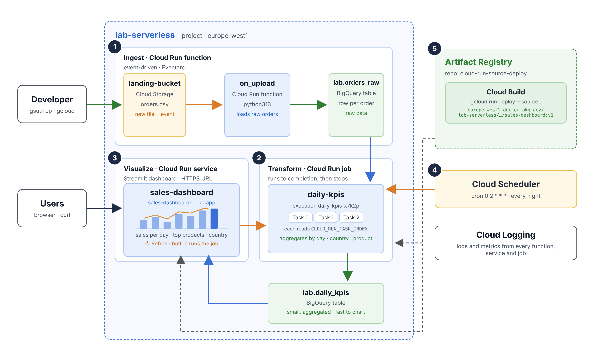

# GCP Cloud Run functions · Cloud Run jobs · Cloud Run services

Hands-on lab for the **Cloud Run & Cloud Run Functions** session.
You will build a complete **ingest → transform → visualize** pipeline with the three flavours of Cloud Run, and complete 5 challenges.



| # | Component | What it does |
|---|---|---|
| 1 | **Ingest** · Cloud Run function `on-upload` | When a CSV lands in `landing-bucket`, Eventarc triggers the function, which cleans the rows and loads them into `lab.orders_raw` (BigQuery). |
| 2 | **Transform** · Cloud Run job `daily-kpis` | Reads `orders_raw` and computes sales per day, country and product into `lab.daily_kpis`. Runs with **3 tasks in parallel**; each one processes its own countries using `CLOUD_RUN_TASK_INDEX`. |
| 3 | **Visualize** · Cloud Run service `sales-dashboard` | Streamlit dashboard that reads `daily_kpis`. The **Refresh** button executes the job. |
| 4 | **Cloud Scheduler** | Executes the job every night at 02:00. |
| 5 | **Artifact Registry** | Stores the images built by `gcloud run deploy --source`. |
| – | **Cloud Logging** | Logs from the function, from each job task and from the service. |

---


## 0. Before you start

- A Google Cloud project **with billing enabled**. The lab fits comfortably within the free tier if you do the clean-up at the end (step 7).
- Use **Cloud Shell** (the `>_` button at the top right of the console): it already includes `gcloud`, `bq`, `git` and Python.

```bash
gcloud config set project YOUR_PROJECT_ID
git clone https://github.com/<user>/gcp-cloud-run-lab.git
cd gcp-cloud-run-lab
```

> Run **all** commands from the repo root folder. If you open another terminal, reload the variables with `source setup/00_env.sh`.

---

## 1. Prepare the project

```bash
bash setup/01_setup.sh
source setup/00_env.sh
```

This enables the APIs and creates the bucket, the `lab` dataset with its two tables, the Artifact Registry repository and **one service account per component** with only the permissions it needs (least privilege).

🔎 Open `setup/01_setup.sh` and find which roles each service account gets. You will need them for the final questions.

---

## 2. Ingest: the function

```bash
bash deploy/01_function.sh
gcloud storage cp data/orders_week1.csv gs://$LANDING_BUCKET/
```

Wait ~30 seconds and check that the data has arrived:

```bash
bq query --nouse_legacy_sql 'SELECT COUNT(*) AS rows FROM lab.orders_raw'
gcloud functions logs read $FUNCTION_NAME --region=$REGION --limit=10
```

Now look at the data quality:

```bash
bq query --nouse_legacy_sql '
SELECT country, COUNT(*) AS rows, MIN(quantity) AS min_qty, COUNTIF(product = "") AS empty_product
FROM lab.orders_raw GROUP BY country ORDER BY country'
```

Notice anything odd? You will fix it in Challenge 1.

---

## 3. Transform: the job

```bash
bash deploy/02_job.sh
gcloud run jobs execute $JOB_NAME --region=$REGION --wait
bq query --nouse_legacy_sql 'SELECT * FROM lab.daily_kpis ORDER BY computed_at DESC LIMIT 10'
```

In the console, go to **Cloud Run → Jobs → daily-kpis → Executions** and open the execution: you will see the **3 tasks**.

Do the `orders`, `units` and `revenue` numbers make sense? You will fix them in Challenge 2.

---

## 4. Visualize: the dashboard

```bash
bash deploy/03_dashboard.sh
```

Open the URL printed at the end. Try the **↻ Refresh** button: it starts a new execution of the job. Check it in the Cloud Run console.

---

## 5. Scheduler

```bash
bash deploy/04_scheduler.sh
gcloud scheduler jobs run $SCHEDULER_NAME --location=$REGION   # run it now instead of waiting until 02:00
```

---

## 6. Challenges 🧩

### Challenge 1 · Clean the data (function)

1. Upload the second week: `gcloud storage cp data/orders_week2.csv gs://$LANDING_BUCKET/`
2. Check whether new rows have reached `orders_raw`. Nothing arrives: **find out why** in the logs (`gcloud functions logs read ...` or in **Cloud Logging**).
3. Complete the `TODO` in `clean_row()` in `function/on_upload/main.py`.
4. Test it locally before deploying:
   ```bash
   pip install -r function/on_upload/requirements.txt pytest
   python -m pytest tests/
   ```
5. Once all tests pass, redeploy, empty the table and upload both files again:
   ```bash
   bash deploy/01_function.sh
   bq query --nouse_legacy_sql 'TRUNCATE TABLE lab.orders_raw'
   gcloud storage cp data/orders_week1.csv data/orders_week2.csv gs://$LANDING_BUCKET/
   ```
6. In the logs, the function reports how many rows it dropped from each file. How many are there?

### Challenge 2 · Compute the KPIs (job)

1. Complete the `TODO` in `job/daily_kpis/kpis.sql` (`orders`, `units`, `revenue`).
   Tip: test the `SELECT` in the BigQuery console first, replacing `@task_count` with `1` and `@task_index` with `0`.
2. Deploy and run:
   ```bash
   bash deploy/02_job.sh
   gcloud run jobs execute $JOB_NAME --region=$REGION --wait
   ```
3. In **Cloud Logging**, look for the lines `Task X/3: N KPI rows written`. Which task processed the most rows? Why aren't they equal?

### Challenge 3 · A new chart (service)

Complete the `TODO` in `service/sales_dashboard/app.py`: add the **Top 5 products by revenue** chart. Don't deploy it yet to test it: that's Challenge 4.

### Challenge 4 · Canary release

Release your version with the new chart **without affecting users**:

```bash
bash deploy/05_dashboard_canary.sh
```

1. Open the `canary---...` URL and check that the new chart appears (the version shows as `app v2`).
2. Send 10% of the traffic to the new version and check the split in **Cloud Run → sales-dashboard → Revisions**.
3. Move to 100% (`--to-latest`). Then **roll back** to the previous revision. Did you have to rebuild the image?

### Challenge 5 · Observe

1. Change the job to 4 tasks (`--tasks=4 --parallelism=4` in `deploy/02_job.sh`) and run it. There are 5 countries: how are they distributed? Does any task end up with no work?
2. Leave the dashboard unopened for 15 minutes. In **Cloud Run → sales-dashboard → Metrics**, look at *Instance count*. What happened?

---

## Questions to think about

1. Why is the KPI calculation a **job** and not a **service**? And why is ingestion a **function**?
2. Each component has its own service account. What could happen if all three used the same one with the `Editor` role?
3. The dashboard reads `daily_kpis` and not `orders_raw`. What is the advantage, in cost and in speed?
4. The dashboard was deployed with `--allow-unauthenticated`. What is the risk in a real company? How would you protect it?
5. If you upload the same CSV twice, what happens to the data? How would you prevent it?

---

## Submission

A document (PDF or link) with:

- [ ] Screenshot of `pytest` with all tests green (Challenge 1) and the number of dropped rows.
- [ ] Your `kpis.sql` and the answers to the Challenge 2 questions.
- [ ] Screenshot of the dashboard with the **3 charts** (Challenge 3).
- [ ] Screenshot of the 90/10 traffic split (Challenge 4).
- [ ] Answers to Challenge 5 and to the 5 questions to think about.

---

## 7. Clean-up (don't skip it!)

```bash
bash setup/99_cleanup.sh
```

---

## Troubleshooting

| Symptom | Solution |
|---|---|
| `PERMISSION_DENIED` right after setup | IAM permissions take 1–2 minutes to propagate. Wait and try again. |
| The function deployment fails with an Eventarc or Pub/Sub error | Wait a couple of minutes after enabling the APIs and run `deploy/01_function.sh` again. |
| `gcloud run deploy --source` fails while building | Check that setup granted the `cloudbuild.builds.builder` role to the `PROJECT_NUMBER-compute@...` account. |
| The dashboard says *No KPIs yet* | Run the job (step 3) and reload the page. |
| No rows reach `orders_raw` | `gcloud functions logs read $FUNCTION_NAME --region=$REGION`: the error will be there. |
| You want to see the solution deployed | All `deploy/` scripts accept the folder as an argument, for example: `bash deploy/01_function.sh solutions/function/on_upload` |
